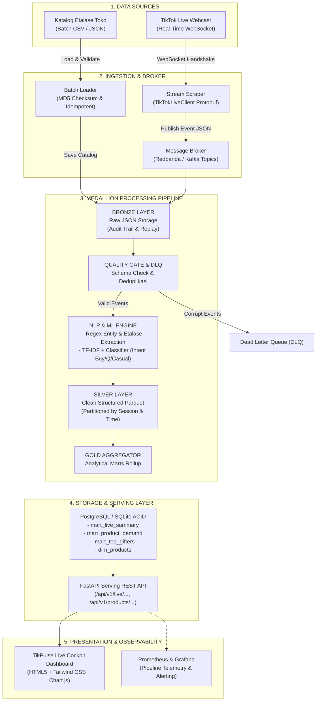

# 🎙️ Panduan Komprehensif Presentasi Proyek: TikPulse Live Commerce Intelligence Platform

> **Topik:** Perancangan Data Platform untuk Monitoring Interaksi Real-Time dan Prediksi Minat Beli pada TikTok Live Commerce  
> **Arsitektur:** Medallion Data Architecture (*Bronze $\to$ Silver $\to$ Gold*) dengan Stream Ingestion, ML NLP Intent Classifier, Data Marts, dan Live Host Cockpit  
> **Target Audiens:** Dosen Penguji, Dosen Pembimbing, dan Praktisi Data Engineering / Data Science

---

## 📑 Daftar Isi
1. [Latar Belakang & Problem Statement](#1-latar-belakang--problem-statement)
2. [Arsitektur Sistem End-to-End (Topologi & Aliran Data)](#2-arsitektur-sistem-end-to-end)
3. [Sumber Data (Data Sources)](#3-sumber-data-data-sources)
4. [Mekanisme Pengambilan Data (Ingestion Layer)](#4-mekanisme-pengambilan-data-ingestion-layer)
5. [Pemrosesan Data & Data Pipeline (Medallion Architecture)](#5-pemrosesan-data--data-pipeline-medallion-architecture)
6. [Machine Learning & Natural Language Processing (NLP)](#6-machine-learning--natural-language-processing-nlp)
7. [Serving Layer & Analytical Data Marts](#7-serving-layer--analytical-data-marts)
8. [Dashboard Interaktif (Live Host Cockpit UI)](#8-dashboard-interaktif-live-host-cockpit-ui)
9. [Tantangan Rekayasa Teknis & Solusi Teruji](#9-tantangan-rekayasa-teknis--solusi-teruji)
10. [Rekomendasi Struktur Slide Presentasi & Script Uji Sidang](#10-rekomendasi-struktur-slide-presentasi--script-uji-sidang)

---

## 1. Latar Belakang & Problem Statement

### Masalah Nyata di Industri (*The Business Problem*)
Pada ekosistem *TikTok Live Shopping*, interaksi penonton berlangsung dengan kecepatan sangat tinggi (bisa mencapai ratusan komentar dan puluhan saweran gift per menit). Host siaran langsung sering menghadapi kendala krusial:
1. **Information Overload:** Host tidak sanggup membaca ratusan chat yang bergulir cepat (*waterfall chat*).
2. **Kehilangan Momentum Konversi (*Lost Sales*):** Pertanyaan berulang seperti *"Kak spill etalase 15 dong"*, *"bisa COD gak?"*, atau *"warna hitam masih ada?"* sering terlewatkan.
3. **Buta Analitik (*No Real-time Intelligence*):** Host tidak mengetahui secara pasti produk mana yang saat itu juga sedang paling banyak dicari atau diperebutkan penonton di keranjang kuning.

### Solusi: TikPulse
**TikPulse** adalah platform analitik data *real-time* yang menyerap aliran siaran langsung TikTok, membersihkan dan memperkaya data dengan katalog toko, memprediksi maksud pembeli menggunakan Machine Learning (*NLP Intent Classifier*), dan menyajikannya secara instan ke dalam **Live Host Cockpit Dashboard**.

---

## 2. Arsitektur Sistem End-to-End

TikPulse dibangun dengan prinsip modularitas, skalabilitas, dan keandalan tinggi mengacu pada **Medallion Data Architecture**:



---

## 3. Sumber Data (Data Sources)

Sistem mengintegrasikan dua tipe data utama (*Hybrid Streaming & Batch*):

| Tipe Data | Sumber Asal | Karakteristik | Frekuensi & Format |
| :--- | :--- | :--- | :--- |
| **Stream Data (Unstructured/Semi-structured)** | TikTok Live Webcast Room via WebSocket | Komentar penonton, pemberian koin/gift, status ruang live, event pin produk | Real-time kontinu ($10\text{--}100\text{ event/detik}$), Protobuf decoded to JSON |
| **Batch Data (Structured)** | File Katalog Produk Toko (`catalog_products.csv` atau JSON kustom) | Nomor etalase, nama produk resmi, kategori/niche, harga (IDR), keywords pencarian | Dimuat saat inisialisasi / diperbarui via modal katalog toko |

---

## 4. Mekanisme Pengambilan Data (Ingestion Layer)

### A. Protokol Webcast TikTok Live (`TikTokLiveClient`)
1. **Koneksi Tanpa Kredensial Berbayar:**
   - Sistem memanfaatkan koneksi langsung ke server Webcast TikTok (`webcast.tiktok.com`) menggunakan library `TikTokLive`.
   - Mengambil handshake token publik room live berdasarkan username streamer (misal `@somethincofficial` atau `@aerostreet`).
2. **Event Listeners:**
   - `CommentEvent`: Menangkap teks obrolan penonton, `user_id`, dan `nickname`.
   - `GiftEvent`: Menangkap nama hadiah saweran, jumlah koin/berlian (*diamonds*), dan pengirim (*sultan leaderboard*).
   - `OecLiveShoppingEvent`: Menangkap event ketika penjual menyematkan (*pin/pop-up*) etalase produk di layar siaran.
   - `DisconnectEvent` & `LiveEndEvent`: Mendeteksi pemutusan jaringan atau saat host mengakhiri live stream.
3. **Enrichment Metadata Ingestion (F-04 Standard):**
   Setiap event yang ditangkap dibungkus dengan metadata standar sebelum diteruskan ke broker:
   ```json
   {
     "event_id": "evt_a1b2c3d4e5f6",
     "session_id": "sess_1794840839_somethincofficial",
     "streamer": "@somethincofficial",
     "event_type": "comment",
     "payload_version": "1.0.0",
     "event_time": "2026-11-17T04:30:00.123Z",
     "ingest_time": "2026-11-17T04:30:00.145Z",
     "data": {
       "user_id": "u_948271",
       "nickname": "Rani_Glow",
       "comment_text": "kak spill etalase 15 ceraplump dong mau checkout"
     }
   }
   ```

### B. Mode Simulasi & Demo (*Safe Fallback Replayer*)
Untuk keperluan presentasi/pengujian di saat toko target sedang offline atau tidak ada koneksi internet stabil, TikPulse menyediakan toggle **Simulasi Demo**. Data simulasi dipancarkan secara deterministik berdasarkan niche toko tanpa mengaburkan status siaran asli.

---

## 5. Pemrosesan Data & Data Pipeline (Medallion Architecture)

Pipeline data dibangun menggunakan 3 layer medallion yang teruji di industri data engineering:

### 1. Bronze Layer (Raw Storage)
* **Tujuan:** Menyimpan data mentah tanpa modifikasi apa pun sebagai sumber kebenaran (*single source of truth*) untuk kebutuhan audit, *replay*, atau *backfilling*.
* **Format & Lokasi:** Format JSON mentah yang disimpan per partisi tanggal/waktu (`year/month/day/hour`) di MinIO Object Storage (S3-compatible) atau disk lokal.

### 2. Quality Gate & Deduplikasi (Bronze $\to$ Silver)
Sebelum masuk ke Silver Layer, setiap event wajib lolos *Quality Gate* ketat:
* **Deduplikasi Idempotent:** Memeriksa `event_id`. Jika ID pernah diproses dalam sesi yang sama, event dibuang (*skip*) untuk mencegah duplikasi metrik.
* **Schema Validation & Null Check:** Memastikan kolom wajib seperti `event_id`, `timestamp`, dan `comment_text` tidak kosong.
* **Dead Letter Queue (DLQ):** Event yang korup atau tidak memenuhi skema otomatis dialihkan ke topik Kafka DLQ (`tiktok.events.dlq`) agar pipeline utama tidak mengalami *crash*.
* **GDPR & PII Anonymization:** Data sensitif penonton disamarkan jika diperlukan sebelum disimpan permanen.

### 3. Silver Layer (Cleaned & Enriched Parquet)
* **Tujuan:** Menyimpan data yang sudah bersih, tervalidasi, diperkaya dengan atribut etalase, dan diberi label hasil inferensi Machine Learning.
* **Format:** **Apache Parquet** dengan kompresi *Snappy*. Parquet dipilih karena menghemat storage hingga $70\%$ dan mempercepat waktu agregasi analitik.
* **Fitur Pengayaan:**
  - `extracted_etalase`: Nomor etalase yang berhasil diekstrak (contoh: `15`).
  - `matched_product_name`: Nama produk resmi dari katalog (contoh: `Somethinc Ceraplump Tinted Lip Glow Balm`).
  - `matched_price_idr`: Harga produk (contoh: `Rp 89.000`).
  - `ml_intent`: Prediksi niat penonton (`INTENT_BUY`, `QUESTION`, `CASUAL`, `COMPLAINT`).
  - `ml_confidence`: Skor probabilitas keyakinan model ML ($0.0\text{--}1.0$).

### 4. Gold Layer (Analytical Serving Marts)
* **Tujuan:** Tabel agregasi tingkat bisnis (*business-level metrics*) yang siap dikonsumsi langsung oleh dashboard dan API.
* **Tabel Gold Marts:**
  1. `mart_live_summary`: Total komentar, total pendapatan saweran koin (dikonversi ke Rupiah), jumlah chat beli (*purchase intent*), pertanyaan, dan komplain.
  2. `mart_product_demand`: Peringkat etalase paling diminati penonton (*demand rank*) dalam sesi tersebut.
  3. `mart_top_gifters`: Peringkat 3 penonton teratas yang memberikan gift koin tertinggi (*Sultan Leaderboard*).
  4. `dim_products`: Dimensi katalog produk toko aktif.

---

## 6. Machine Learning & Natural Language Processing (NLP)

### A. Ekstraksi Entitas & Etalase (Rule-based & Regex NLP)
Penonton siaran langsung menggunakan bahasa gaul (*slang*) yang sangat bervariasi. TikPulse menerapkan regex bertingkat dengan **Word Boundaries (`\b`)** untuk menghindari pemotongan kata:
1. **Deteksi Nomor Etalase:**
   - Pola regex: `\b(?:no|nomor|etalase|etls|eta|co|spill|#)\s*([0-9]{1,2})\b`
   - Mampu menangkap *"spill 15"*, *"eta 2"*, *"co nomor 3"*, *"etalase 1"*.
2. **Kecocokan Kata Kunci Katalog (*Longest Keyword Matching*):**
   - Jika penonton tidak menyebut nomor etalase (misal *"kak pelembab calm down nya ready?"*), sistem mencocokkan kata kunci di katalog dengan memprioritaskan frasa terpanjang/paling spesifik.
3. **Ekstraksi Subjek Produk (*Fallback Subject Extraction*):**
   - Jika nomor atau nama produk belum terdaftar di katalog resmi, sistem membersihkan *stopwords* obrolan live (`kak`, `dong`, `spill`, `co`, `ready`, dll) dan mengekstrak entitas subjek unik.

### B. Model Klasifikasi Niat Pembeli (ML Intent Classifier)
* **Kategori Intent:**
  - `INTENT_BUY`: Penonton berniat membeli, menanyakan cara checkout, ketersediaan stok, diskon, atau promo.
  - `QUESTION`: Pertanyaan teknis produk (bahan, ukuran berat/tinggi badan, warna asli, durasi pengiriman).
  - `CASUAL`: Sapaan ramah, candaan, atau teks obrolan santai antarpenonton.
  - `COMPLAINT`: Keluhan pesanan, barang rusak, pengiriman lambat, atau komplain respon admin.
* **Arsitektur Model:**
  - **Feature Extraction:** `TfidfVectorizer(ngram_range=(1, 2))` (menangkap unigram dan bigram kata).
  - **Classifier Algorithm:** `LogisticRegression` & `MultinomialNB` / `RandomForest`.
  - **Alasan Pemilihan:** Memberikan waktu inferensi sangat cepat ($< 3\text{ ms}$ per kalimat) dan penggunaan memori ultra-ringan ($< 15\text{ MB}$), sehingga sangat ideal untuk *online inference real-time*.
* **MLOps & Tracking dengan MLflow:**
  - Seluruh hyperparameter, metrik evaluasi ($F_1\text{-Score}$, Precision, Recall, Accuracy), dan artefak model (`model_intent.joblib`) dilacak dan diverifikasi melalui MLflow Experiment Registry.

---

## 7. Serving Layer & Analytical Data Marts

### A. Backend Architecture (FastAPI + Database Hybrid)
* **FastAPI:** Framework Python asinkron berperforma tinggi yang menyediakan REST API berdokumen OpenAPI/Swagger interaktif.
* **Dual-Database Architecture (ACID Fallback):**
  - **Primary:** PostgreSQL untuk lingkungan *production*.
  - **Fallback:** SQLite otomatis aktif tanpa *downtime* jika PostgreSQL sedang *maintenance* atau belum dijalankan di Docker.

### B. Endpoint REST API Utama (`/api/v1/...`)
* `GET /api/v1/live/summary`: Ringkasan metrik real-time sesi live stream aktif.
* `GET /api/v1/live/comments`: Aliran komentar terbaru yang sudah diberi tag NLP & ML.
* `GET /api/v1/products/demand`: Peringkat Top 5 etalase paling diminati penonton.
* `GET /api/v1/gifters/leaderboard`: Peringkat Top 3 donatur saweran koin terbesar.
* `POST /api/v1/session/switch`: Mengganti target akun streamer TikTok yang sedang dipantau.
* `GET /api/v1/catalog` & `POST /api/v1/catalog/update`: Mengambil dan memperbarui katalog etalase toko.

### C. Keamanan & Role-Based Access Control (RBAC)
Endpoint dilindungi oleh verifikasi header peran (`X-User-Role`):
- `viewer`: Akses baca (*read-only*) analitik live summary, produk, dan komentar.
- `admin`: Hak istimewa untuk memperbarui katalog produk, memicu pipeline data manual, dan mengubah konfigurasi siaran.

---

## 8. Dashboard Interaktif (Live Host Cockpit UI)

Dashboard TikPulse dirancang khusus untuk kenyamanan host siaran langsung:
1. **Banner Status Siaran yang Jujur & Transparan:**
   - Menampilkan badge jelas `🟢 REAL-TIME TIKTOK LIVE` saat streamer sedang online.
   - Menampilkan banner `🔴 Toko Sedang Tidak Live` saat akun offline, menghindari manipulasi data.
2. **AI Host Teleprompter & Live Copilot:**
   - Memberikan rekomendasi verbal instan kepada host secara *real-time*: *"Etalase #15 sedang banyak diminta! Segera sematkan dan tawarkan promo terbatas!"*
3. **Live Chat Waterfall:**
   - Menampilkan komentar penonton dengan badge kategori warna (`HIJAU: Niat Beli`, `BIRU: Pertanyaan`, `MERAH: Komplain`).
4. **Leaderboard Top 5 Produk Terlaris:**
   - Menampilkan 5 produk teratas lengkap dengan harga dan persentase minat beli.
5. **Fitur "📋 Tempel Cepat (Quick Paste)" Modal Etalase:**
   - Memungkinkan host/operator menyinkronkan 20+ etalase toko hanya dalam 5 detik dengan menempelkan teks daftar produk.

---

## 9. Tantangan Rekayasa Teknis & Solusi Teruji

| No | Tantangan Teknis | Dampak Awal | Solusi Rekayasa TikPulse |
| :---: | :--- | :--- | :--- |
| **1** | **Privasi Keranjang Kuning TikTok** | TikTok Webcast hanya mengirim komentar & saweran, tidak memancarkan daftar harga/SKU keranjang kuning tanpa API Merchant resmi. | 1. Memasang listener `OecLiveShoppingEvent` untuk menangkap produk saat di-pin.<br/>2. Menyediakan fitur *Quick Paste* di UI untuk sinkronisasi katalog 5 detik. |
| **2** | **Kebocoran Data Antar-Toko (*Data Leakage*)** | Saat berganti toko di dashboard, data toko sebelumnya sempat bercampur di database. | Menerapkan arsitektur **Session-Scoped Keys** (`session_id = sess_<timestamp>_<streamer>`) pada seluruh tabel Gold Marts. |
| **3** | **Toko Target Sedang Offline** | Pengujian atau presentasi gagal jika toko target sedang tidak siaran langsung. | Menyediakan toggle **Simulasi Demo Terkontrol** yang menghasilkan data realistis sesuai niche toko tanpa memalsukan status online. |
| **4** | **Fragmentasi Bahasa Gaul (*Slang NLP*)** | Regex sederhana memotong kata seperti `etalase` menjadi `lase` atau `saya` menjadi `sa`. | Menambahkan *word boundaries* (`\b`) pada regex pembersihan teks sehingga kata dasar bahasa Indonesia tetap utuh. |
| **5** | **Deteksi Niche Toko Baru** | Toko baru yang belum terdaftar di katalog bisa salah diklasifikasikan industrinya. | Arsitektur **3-Layer Hybrid Niche Detection**: Brand Resmi $\to$ Manual Override UI $\to$ Consistent MD5 Hash Assignment. |

---

## 10. Rekomendasi Struktur Slide Presentasi & Script Uji Sidang

Gunakan susunan 10–12 slide berikut untuk presentasi di hadapan dosen/evaluator:

### Slide 1: Judul & Identitas
* **Judul:** TikPulse: Real-Time Live Commerce Intelligence Platform
* **Subjudul:** Monitoring Interaksi Real-Time dan Prediksi Minat Beli pada TikTok Live Shopping Menggunakan Medallion Architecture
* **Nama & NIM Anggota Tim**

### Slide 2: Latar Belakang & Urgensi Masalah
* Fenomena ledakan transaksi TikTok Live Commerce di Indonesia.
* Masalah host: chat terlalu deras, hilangnya momentum penjualan, dan ketiadaan data instan.
* Rumusan masalah dan tujuan platform.

### Slide 3: Topologi Arsitektur End-to-End
* Tampilkan diagram alir Medallion Architecture (*Bronze $\to$ Silver $\to$ Gold*).
* Jelaskan peran masing-masing komponen: Redpanda, MinIO/Parquet, PostgreSQL, FastAPI, dan Dashboard.

### Slide 4: Ingestion & Mekanisme Pengambilan Data
* Bagaimana data ditangkap langsung dari server TikTok Webcast tanpa API berbayar.
* Protobuf event handling: `CommentEvent`, `GiftEvent`, `OecLiveShoppingEvent`.
* Format standar pembungkus event (*metadata schema*).

### Slide 5: Data Quality Gate & Medallion Transformation
* **Bronze:** Raw data audit trail.
* **Pembersihan:** Deduplikasi berbasis `event_id`, validasi skema, dan routing korup ke DLQ.
* **Silver:** Format kolumnar Parquet terkompresi.

### Slide 6: Machine Learning NLP Intent Classifier
* Formulasi klasifikasi 4 kelas: *Purchase Intent*, *Question*, *Casual*, *Complaint*.
* Pipeline model: TF-IDF n-gram + Logistic Regression.
* Metrik evaluasi ($F_1\text{-score}$, akurasi, latensi $< 3\text{ ms}$).
* Integrasi MLOps dengan MLflow.

### Slide 7: Serving Layer & Analytical Marts
* Desain skema tabel Gold: `mart_live_summary`, `mart_product_demand`, `mart_top_gifters`.
* Keamanan data: Isolasi sesi (*zero data leakage*) dan RBAC (*Viewer vs Admin*).
* Mekanisme ACID Fallback: PostgreSQL dengan SQLite auto-switch.

### Slide 8: Demo Live Cockpit Dashboard
* Tampilkan *screenshot* atau video singkat dashboard aktif.
* Sorot fitur utama: Teleprompter AI, Chat Waterfall, Leaderboard Etalase, dan Status Toko.

### Slide 9: Solusi Rekayasa Khusus (Engineering Highlights)
* Solusi batasan keranjang kuning TikTok (*OEC Shopping Pin Event* + *Quick Paste 5-detik*).
* Regex NLP anti-pecah kata (*Word Boundaries*).
* Hybrid Niche Detection.

### Slide 10: Pengujian & Validasi Sistem (Testing & Metrics)
* Hasil eksekusi *Unit Tests* (`pytest tests` lolos 100%).
* Latensi pemrosesan end-to-end ($< 100\text{ ms}$ dari chat penonton hingga muncul di dashboard).
* Efisiensi memori (berjalan lancar di laptop spesifikasi standar).

### Slide 11: Kesimpulan & Rencana Pengembangan Masa Depan
* Kesimpulan pencapaian proyek sesuai spesifikasi TBP.
* *Future works:* Integrasi LLM (Large Language Model) untuk auto-reply chat cerdas dan analitik speech-to-text suara host live.

### Slide 12: Sesi Tanya Jawab (Q&A Defense Tips)
> **💡 Antisipasi Pertanyaan Dosen Penguji:**
> 1. *T: "Kenapa memilih Redpanda daripada Apache Kafka?"*  
>    **J:** Redpanda ditulis dalam C++ tanpa beban JVM dan ZooKeeper, menghemat RAM hingga 70% dan sangat efisien untuk latensi streaming tinggi.
> 2. *T: "Bagaimana jika toko target sedang offline saat didemokan?"*  
>    **J:** Sistem memiliki sensor deteksi live otomatis. Jika offline, sistem menampilkan status offline secara transparan, namun kami melengkapinya dengan modul simulasi replayer yang aman untuk evaluasi fungsionalitas.
> 3. *T: "Kenapa menggunakan Logistic Regression/MultinomialNB bukan Deep Learning (misal IndoBERT)?"*  
>    **J:** Untuk online streaming inference real-time ($50\text{--}100\text{ chat/detik}$), model TF-IDF + Logistic Regression hanya membutuhkan waktu $< 3\text{ ms}$ dan memori $< 15\text{ MB}$, sedangkan BERT membutuhkan GPU dan latensi $> 100\text{ ms}$ per inferensi.
